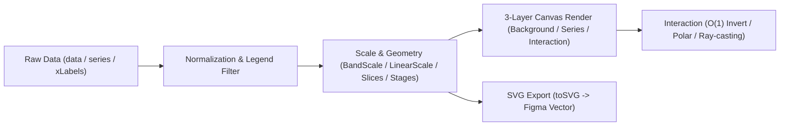

# 아키텍처 명세서 (`docs/ARCHITECTURE.md`)

> **문서 목적:** `@ju9nu7/nanocharts` (`v0.1.16`)의 폴더 구조, 데이터에서 렌더링·인터랙션·SVG 추출로 이어지는 핵심 파이프라인, 내부 상태 관리 및 60fps 최적화 구조를 정리합니다.

---

## 1. 모듈 계층 및 폴더 구조

```
src/
├── index.ts                # Public Export 진입점
├── types/index.ts          # 전역 타입 및 인터페이스 단일 진실 원천(SSOT)
├── core/                   # 오케스트레이터 & 인프라 (Chart, LineChart, PieChart, DonutChart, FunnelChart, LayerManager, Animator, EventEmitter)
├── scale/                  # 데이터 ↔ 픽셀 좌표 변환 엔진 (Scale, LinearScale, BandScale)
├── series/                 # 순수 Canvas 2D 도형 및 SVG 직렬화 렌더러 (BarSeries, LineSeries, PieSeries, FunnelSeries)
├── components/             # 보조 시각화 및 DOM 인터랙션 컴포넌트 (Axis, Grid, Tooltip, Legend)
└── utils/                  # 드로잉(canvas), 디자인 토큰(tokens), 반응형(responsive), SVG 직렬화(svg)
```

---

## 2. 핵심 렌더링 & 인터랙션 파이프라인



### 단계별 동작 흐름

1. **Raw Data → Normalization & Legend Filter**
   - `BarChart`·`LineChart`의 다중 시리즈(`series`)는 `normalizeMultiSeries()`에서 `maxLen` 기준으로 슬롯 길이를 맞추고 `number | DataItem`을 표준 `DataItem` 배열로 정규화합니다.
   - `Legend`의 `hiddenKeys` (`Set<string>`)를 기준으로 `activeData` 또는 `activeSeries`를 필터링합니다.
2. **Scale & Geometry 계산**
   - **직교 좌표계 차트 (`BarChart`, `LineChart`)**:
     - `BandScale`: `setDomainCount(slotCount)`와 `range([eff.left, width - eff.right])`로 X축 슬롯 및 뷰포트 윈도우(`[viewStart, viewEnd]`)를 관리합니다.
     - `LinearScale`: 최솟값/최댓값에 상하 10% 여유를 준 뒤 `.nice(5)`로 도메인을 보정하고, `range([height - eff.bottom, eff.top])`로 Y축 픽셀 매핑을 수행합니다.
     - `LineChart`의 `stacked: true` 모드에서는 `initScales()` 시점에 각 시리즈의 `baseValues[]`와 `stackedValues[]`를 사전 누적 계산합니다.
   - **비직교 좌표계 차트 (`PieChart`, `DonutChart`, `FunnelChart`)**:
     - `PieSeries.calculateSlices()`: 중심점 `(cx, cy)`, 반응형 반지름, 12시(`-PI/2`) 기준 시작/종료 각도, 잔여 `isTrack` 조각을 계산해 `this.slices`에 캐싱합니다.
     - `FunnelSeries.calculateStages()`: 진행 방향(`vertical`/`horizontal`)과 형태(`trapezoid`/`bar`)에 따라 4개 꼭짓점 다각형(`points`) 및 단계별/전체 전환율을 계산해 `this.stages`에 캐싱합니다.
3. **3단 멀티 레이어 Canvas 렌더링 (`LayerManager`)**
   - **`background` (z-index: 1, `pointer-events: none`)**: `Grid.render()`, `Axis.renderYAxis()`, `Axis.renderXAxis()`를 렌더링합니다. 애니메이션 프레임 중에는 다시 그리지 않고 1회만 고정 렌더링합니다.
   - **`series` (z-index: 2, `pointer-events: none`)**: `Animator`의 `progress (0 → 1)`에 따라 데이터 도형과 라벨을 그립니다.
     - `BarSeries`: 뷰포트 컬링(`[start, end]`) + 높이 성장(Grow) 애니메이션.
     - `LineSeries`: 좌→우 클리핑 와이프(Wipe) + 수직 상승 보간, 포인트 수가 `samplingThreshold`(`600`)를 초과하면 `downsampleLTTB()` 적용.
     - `PieSeries`: 360° 시계 방향 Sweep + 반지름 85%→100% 확장.
     - `FunnelSeries`: 단계 크기 확장 애니메이션.
   - **`interaction` (z-index: 3, `pointer-events: auto`)**: 유일하게 마우스/터치 이벤트를 수신하며, 호버 하이라이트와 크로스헤어만 독립적으로 지우고(`clear('interaction')`) 다시 그립니다.
4. **인터랙션 & 히트 테스팅**
   - `BarChart` / `LineChart`: `xScale.invert(mouseX)`로 $O(1)$ 슬롯 인덱스를 역산합니다. 다중 `LineChart`에서는 해당 슬롯의 활성 시리즈 중 `|pt.y - mouseY|`가 최소인 시리즈를 강조합니다.
   - `PieChart`: 중심점 기준 극좌표 `(distance, atan2)`로 조각을 판정하며, 호버 시 `hoverRatios[]`를 `requestAnimationFrame` Lerp(`smoothing = 0.22`)로 보간하여 부드러운 팝아웃(`series` 레이어 재렌더)을 구동합니다.
   - `FunnelChart`: `isPointInStage()`의 Ray-casting 다각형 내부 판정 알고리즘으로 호버 단계를 검출합니다.
   - 모든 차트에서 호버 변경 시 `Legend.setHoveredKey()`, `Tooltip.show()`/`showMulti()`, `EventEmitter.emit('hover', ...)`가 양방향 동기화됩니다.
5. **SVG 벡터 추출 (`toSVG`)**
   - 현재 활성 데이터와 `getEffectivePadding(svgW, svgH)`를 기준으로 `Grid`, `Axes`, `Series`, `Legend`의 SVG 그룹을 조합해 `wrapSvgDocument()`로 반환합니다. `BarChart`/`LineChart`는 추출 직후 원래 캔버스 스케일 범위를 `syncScaleRanges()`로 복원합니다.

---

## 3. 상태 관리 및 성능 최적화 구조

### 3.1 인스턴스 내부 상태 (Stateful Orchestrator)

| 상태 그룹 | 주요 필드 | 갱신 시점 |
| :--- | :--- | :--- |
| **데이터 캐시** | `activeData`, `allNormalizedSeries`, `activeSeries`, `slices`, `stages` | `constructor`, `update()`, `Legend` 토글 시 |
| **뷰포트 & 크기** | `width`, `height`, `padding`, `xScale._viewStart/_viewEnd` | `ResizeObserver`, `resize()`, 휠 줌, 드래그 팬 |
| **인터랙션 상태** | `hoveredIndex`, `hoveredSeriesKey`, `hoveredLegendKey`, `isDragging`, `hoverRatios[]` | 마우스/터치 이벤트, 범례 호버 |
| **애니메이션 제어** | `animator (rafId)`, `hoverRafId`, `hasRenderedOnce` | 최초 `resize()` 1회 자동 재생, `update()` 데이터/모드 변경 시, `replayAnimation()` |

### 3.2 렌더링 최적화 기법

- **레이어 격리**: 호버/크로스헤어 이동 시 `background`와 `series` 레이어를 건드리지 않고 `interaction` 레이어만 갱신합니다 (`PieChart`·`FunnelChart`는 조각 팝아웃/글로우 특성상 `series` 레이어 갱신).
- **뷰포트 컬링 (Viewport Culling)**: `BarSeries`와 `LineSeries`는 `xScale.getViewport()`의 `[start, end]` 구간만 순회합니다 (`LineSeries`는 경계 곡선 연속성을 위해 `start - 1` ~ `end + 1` 포함).
- **LTTB 다운샘플링 (`downsampleLTTB`)**: `LineSeries`에서 뷰포트 내 포인트가 `samplingThreshold`(기본 `600`)를 넘으면 삼각형 넓이 최대화 알고리즘으로 시각적 극값을 보존하며 포인트 수를 축소합니다.
- **High-DPI 버퍼 스케일링**: `LayerManager.resize()`에서 `canvas.width = Math.floor(width * dpr)`, `ctx.resetTransform(); ctx.scale(dpr, dpr)`로 Retina 해상도를 유지합니다.
- **리소스 해제 (`destroy`)**: 모든 차트 `destroy()`는 `animator.cancel()`, `resizeObserver?.disconnect()`, `window.removeEventListener('mouseup', ...)`, `layerManager.destroy()`, `tooltip.destroy()`, `legend.destroy()`, `EventEmitter.clear()`를 호출해 메모리 누수를 방지합니다.
